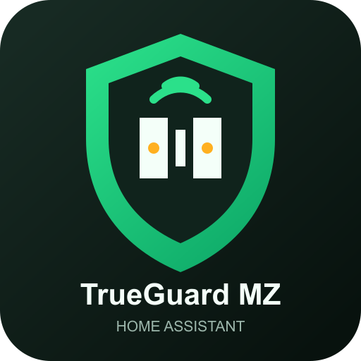

# TrueGuard MZ for Home Assistant

<p align="center">
  
</p>

<p align="center">
  <a href="https://my.home-assistant.io/redirect/hacs_repository/?owner=MRDonnii&repository=trueguard-mz-home-assistant&category=integration">
    
  </a>
</p>

A local Home Assistant integration for older TrueGuard MZ, SecPro Sikring,
and compatible Climax alarm panels with the built-in `WebPanel` interface.

## Features

- Automatic DHCP discovery for compatible Climax panels.
- Active local-network discovery using the `WebPanel` HTTP fingerprint.
- Manual hostname or IP setup as a fallback.
- Automatic IP updates when a DHCP-discovered panel changes address.
- User-selectable polling interval from 0.5 to 3600 seconds.
- Alarm control with disarm, full arm (`Fuldtilkoblet`), and partial arm (`Deltilkoblet`).
- Triggered state from the panel's Contact ID report list, with the alarm
  cause, zone, and time as attributes and a **Seneste alarm** sensor.
- **Sidste hændelse** sensors for the panel and for every zone, built from the
  panel's event log.
- A `trueguard_mz_event` event and a logbook entry for every new log row.
- Battery, tamper, and supervision (connection) binary sensors for every
  wireless zone.
- Panel tamper, 230 V failure, panel battery, and radio jamming sensors.
- GSM module status and the panel firmware version on the device page.
- Exit and entry countdowns: the alarm shows `arming` during the panel's exit
  delay and `pending` during the entry delay of an entry zone, with a
  `countdown_until` attribute. Delays, siren time, and supervision time are
  read from the panel and exposed as attributes.
- Optional push receiver: the panel's own alarm reporting (SIA DC-09 with
  Contact ID or SIA codes, or raw Contact ID over IP) is received directly by
  the integration, so alarms, arming, and faults show up at once.
- **Ur-afvigelse** sensor: how far the panel clock is from Home Assistant, in
  minutes.
- Door and window contacts, smoke, CO, heat, gas, glass-break, motion, and
  moisture sensors.
- On/off modules as switches, dimmer modules as lights with brightness, and
  blind modules as covers (Op / Ned / Stop).
- PIR cameras (`PIR m. kamera`): a camera entity with the newest picture from
  Billeder/Video, **Tag billede** buttons (with and without flash), a
  `trueguard_mz_image` event, and optional saving of every picture under
  `/media/trueguard_mz`.
- Temperature in °C for zones whose status shows a temperature, with the
  panel's high/low alarm limits as attributes.
- **Fejl** per zone (the device table's Tilstand column, the active-fault
  list, or sensor trouble) and **Udkoblet** per zone ("Permanent deaktiver" or
  an automatic zone bypass when arming with an open zone).
- **Rapportering** (the newest report could not be delivered), **Gå-test**,
  and, with the push receiver, **Rapportering virker** based on the panel's
  Auto check-in.
- Arm modes follow the panel's buttons: Deltilkobling 1/2/3 become home,
  night, and custom bypass when the panel has them.
- **Tag backup** button and an optional monthly backup of the panel
  configuration (`cfg.bin`) under `/config/trueguard_mz/backups` (12 kept).
- GSM signal sensor when the panel shows one (needs a SIM card).
- Diagnostic signal sensors.
- Zone names and types follow the panel: a rename on the panel updates the
  device in Home Assistant, and added or removed zones reload the integration.
- Diagnostics download with credentials and MAC address redacted.
- Local communication only; no cloud account is required.
- UI setup, reauthentication, reconfiguration, and options flows.

## Installation with HACS

Until the integration is included in the default HACS catalogue, add it as a
custom repository:

1. Open HACS in Home Assistant.
2. Open the menu and choose **Custom repositories**.
3. Add `https://github.com/MRDonnii/trueguard-mz-home-assistant` as category
   **Integration**.
4. Install **TrueGuard MZ** and restart Home Assistant.

## Manual installation

1. Copy `custom_components/trueguard_mz` into Home Assistant's
   `/config/custom_components/` directory.
2. Restart Home Assistant.
3. Open **Settings > Devices & services > Add integration**.
4. Search for **TrueGuard MZ**.

## Setup

Choose **Find panel automatically** to scan the local IPv4 networks selected
under Home Assistant's network settings. Discovery first checks the anonymous
HTTP authentication challenge. Credentials are only sent to hosts that expose
the expected `WebPanel` fingerprint.

If discovery cannot reach the panel because of VLAN or container routing,
choose **Enter address manually** and enter a local hostname or URL, for
example `http://alarm-panel.local`.

The username and password are the credentials used by the panel's local web
interface. They are stored in Home Assistant's config-entry storage and are
never sent to a cloud service.

## Polling interval

The intervals can be selected during setup and changed later under:

**Settings > Devices & services > TrueGuard MZ > Configure**

- **Polling interval** (0.5-3600 seconds): each poll downloads `control.htm`
  and `device.htm` in parallel. A short interval gives faster contact updates
  but creates more load on the panel's embedded web server. Start at 5 or 10
  seconds and increase the value if the panel reports timeouts.
- **Event log interval** (2-3600 seconds, default 10): how often
  `history.htm` and `rptevent.htm` are read. They are also read at once when
  the arm state or a zone changes, so the cause of a change shows up quickly.

The GSM page is read every five minutes, `area.htm` and `panel.htm` (times and
clock) every hour, and `index.htm` once at startup.

## Push reports from the panel (SIA / Contact ID)

The panel can send every alarm, arm/disarm, and fault report to up to eight
receivers under **Rapport indst.** The integration can be one of them, so it
does not have to wait for the next poll.

1. In Home Assistant: **Settings > Devices & services > TrueGuard MZ >
   Configure**. Turn on **Receive reports from the panel**, keep port `52010`
   (or pick another free port), and optionally enter an account number.
2. On the panel: **Rapport indst.**, pick a **free** row and set **Til** to

   ```
   ip://1234@HOME-ASSISTANT-IP:52010/CID_SIA
   ```

   where `1234` is the account number. Save, then press **Test**.
3. The diagnostic sensor **Sidste kontakt fra centralen** shows the time of
   the last report.

Never change a row that is already in use, for example the TrueConnect row
(`ip://…@www.trueconnect.dk…`) or a monitoring centre: that would stop their
alarms. `/SIA` (SIA codes) and `/CID` (raw Contact ID) also work. Encrypted
reporting (`/SES`) is not supported.

Only connections from the panel's own IP address are accepted, and the
traffic is not encrypted, so keep the panel and Home Assistant on a trusted
LAN. With Home Assistant OS the port needs no mapping. In Docker, publish the
port or use host networking.

Every received report fires a `trueguard_mz_report` event with `format`,
`account`, `cid`, `code`, `qualifier`, `sia_code`, `group`, `zone`, and
`zone_name`. Alarm and fault reports update the entities at once and make the
integration read the event log and report list right away.

## Contact ID codes

Besides alarms, arming, tamper, battery, supervision, mains, and jamming, the
integration understands 121 (duress: fires the event but never shows the alarm
as triggered), 144 and 147 (sensor tamper and supervision), 309/311 (panel
battery), 374 (armed with fault), 380 (sensor fault), 456 (partial arm), 570
(zone bypass), 607 (walk test), and 628 (programming finished: the settings are
read again).

## Events and automations

Every new row in the panel's event log fires a `trueguard_mz_event` event:

```yaml
trigger:
  - trigger: event
    event_type: trueguard_mz_event
    event_data:
      event: Lavt batteri
```

The event data contains `time`, `device`, `user`, `event`, `zone`, `zone_name`,
and `config_entry_id`. Rows already in the log when Home Assistant starts do
not fire events.

## How states are derived

The panel reports Contact ID codes in its report list (`rptevent.htm`), for
example `1130` for a burglary alarm and `3130` for its restore. The first digit
is the qualifier (1 = new event, 3 = restore) and the last three digits are the
event code.

- **Triggered**: a burglary alarm keeps the alarm entity triggered while the
  panel is armed, until the panel is armed or disarmed again. Fire, water,
  panic, and other 24-hour alarms are also shown while disarmed, until the zone
  restores. A reported alarm is shown as triggered for the panel's siren time
  (one hour if the siren time is not set).
- **Arming and pending**: after the panel changes from disarmed to armed, the
  exit delay for that mode shows as `arming`. While armed, opening a zone whose
  attribute is `Indgang1` or `Indgang2` shows the matching entry delay as
  `pending`.
- **Battery, tamper, and supervision**: the device table's own columns win,
  then the panel's active-fault list. Otherwise the newest matching row in the
  report list or event log decides.
- **Panel restarts**: log and report rows from before the newest panel start
  ("Enhed tændt") are ignored, because the panel forgets battery, tamper, and
  alarm states when it restarts.

## Security

These panels normally use unencrypted HTTP Basic authentication. Keep the
panel and Home Assistant on a trusted local network or isolated VLAN, and do
not expose the WebPanel to the internet.

Normal polling and discovery are read-only. Arming, disarming, and switch
commands are only sent when their corresponding Home Assistant entity action
is called.

## Troubleshooting

- Automatic discovery scans only enabled private IPv4 interfaces known to
  Home Assistant and limits broad networks to the local `/24` segment.
- If the panel is on another VLAN, allow Home Assistant to reach TCP port 80
  or use manual setup.
- If authentication fails, verify that the same credentials work in the local
  WebPanel.
- If entities update slowly, reduce the polling interval under **Configure**.
- Download diagnostics from the integration page to see the parsed device
  table, event log, and report list.
- If the panel becomes unstable, increase the interval and check the Home
  Assistant log for `trueguard_mz` messages.

## Removal

Remove the integration from **Settings > Devices & services**, then uninstall
it from HACS. Restart Home Assistant after removing the custom component.

## License

MIT
